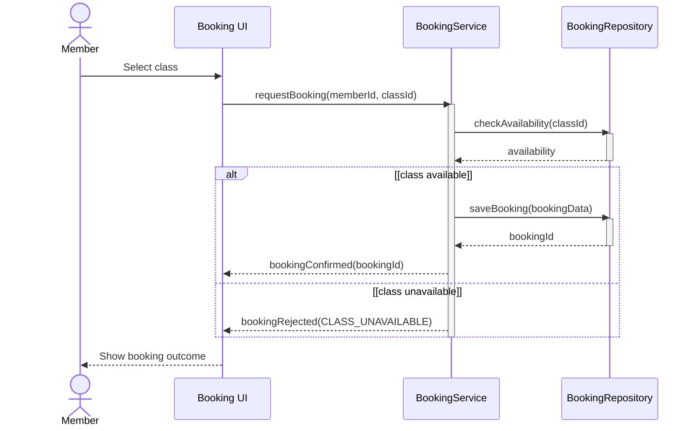

# Codex Rules — SCMS UML Sequence Diagrams (Mermaid for draw.io)

> Scope: Every Mermaid sequence diagram generated or edited under `docs/sequence-diagrams/` for **Sports Center Management System (SCMS)**. When this file is placed at `docs/sequence-diagrams/AGENTS.md`, Codex should follow it for work in that directory. If a higher-priority instruction conflicts, follow that instruction and report the conflict.
>
> **Required output: valid Mermaid `sequenceDiagram` source** (`.mmd`), ready to paste into draw.io. Do not output a draw.io XML file, a flowchart, PlantUML, an image, or a pseudo-sequence diagram unless explicitly asked.

## 1. Visual reference and visual identity — MUST FOLLOW

The reference supplied by the user is `SequenDiagramDiagram.drawio` (Car Booking & Deposit Payment). It contains seven lanes in this left-to-right order:

`Customer | Booking UI | BookingService | VehicleRepository | BookingRepository | PaymentService | PaymentRepository`.

Observed characteristics to **emulate**:

1. **One stick-figure actor** on the far left (e.g. `actor Member as Member`). Use one primary actor per diagram; add a second actor only if the workflow genuinely involves a second human role.
2. **UML sequence, not flowchart**. Each participant has a header at the top and a vertical dashed lifeline. Lay out lanes from **left to right: Actor → UI → Controller/API (only if present in code) → Service(s) → Repository/Model/DB → external integration**.
3. **Calls are horizontal solid arrows with filled arrowheads**: `A->>B: method(parameters)`; **returns are horizontal dashed arrows**: `B-->>A: result`. Keep labels above their corresponding arrows and concise.
4. **Slim activation rectangles** over service/repository lifelines: explicit `activate X` and `deactivate X` for meaningful work; no long, full-diagram activation for an actor/UI. Always balance activations and make nesting plausible.
5. **White or neutral default background, black/gray strokes, no decorative color, no emoji**, and no unnecessary notes or icons. Use default Mermaid styling; do not rely on unsupported custom CSS, `themeVariables`, HTML, or exact coordinates.
6. **Top-to-bottom timeline**. A clear primary request starts near the top; validation, persistence, side effects, response and UI feedback follow chronologically.
7. **Wide, clean spacing**: prefer 5–8 participants per diagram (the reference uses 7). Split complex flows rather than squeezing 10+ lanes into a diagram.
8. **UML conditional frames**: `alt` / `else` / `end`, with readable condition labels; `opt` for an optional step, `loop` for real repetition. Never use an unguarded free-floating condition box.
9. **One diagram per business use case**, not all SCMS features in one giant sequence. Use short English identifiers for participants, real method/endpoint names if verified, English action messages resembling the reference.
10. **Do not copy errors from the reference**: the reference's `Car not available` condition is placed too late, some connectors are detached in XML, and successful payment does not show a booking status update. Preserve the *visual vocabulary*, not those defects.

**Visual fidelity limit:** Mermaid imported into draw.io is auto-laid out and does **not** preserve the exact original draw.io `umlLifeline` geometry, custom widths, or manual connector coordinates. Match its actor/lane/arrow/frame/activation style and overall reading order; do not promise a pixel-identical image.

## 2. Project vocabulary and evidence rules — MUST FOLLOW

**SCMS known roles:** Guest, Member, Coach, Receptionist, Center Manager. External systems mentioned in project context: SMTP email for OTP; Google Maps / OSRM / Nominatim for location; Socket.IO for realtime chat/notifications. Implemented APIs and repositories must be verified in the **current repository**, not inferred solely from this list.

Before drafting each diagram, inspect the relevant implementation/specification, using this evidence priority:

1. Existing code: route definitions, controllers, middlewares, services, data/repository access, validation, database models, WebSocket handlers.
2. OpenAPI/Swagger (`/api/v1/docs` if accessible in the workspace), tests, API contract.
3. Project requirements and user-provided business rules.
4. Explicitly labeled assumptions **only when no source exists**.

Rules:

- Use names from actual code (`BookingController`, `bookingService`, etc.) **when verified**. Do **not** invent an MVC layer or `*Repository` where real code directly uses Mongoose models or a database client. A lane may be named `BookingModel`/`DB` if that is what the code uses.
- Distinguish **IMPLEMENTED** flows from **PLANNED** flows in a file comment (`%% STATUS: IMPLEMENTED` or `%% STATUS: PLANNED - requirement only`). Do not silently draw an imagined endpoint as implemented.
- Never invent URLs, payment providers, refunds, SMTP verification internals, Socket.IO event names, membership status literals, endpoints, secret TTLs, or notification queues. Preserve verified names and behavior.
- If a needed detail is absent, write a neutral action like `validateBookingEligibility(...)` and add `%% ASSUMPTION: ...` outside the diagram's visible arrows; summarize unresolved assumptions separately to the user.
- Do not include access tokens, QR secrets, private keys or real user data in a diagram.
- The flow must be **business-correct**, even if the reference graphic's logic was not.

### Domain-critical business rules

1. **Class booking cutoff:** the class date must be **strictly before** `subscription.endDate` (per SCMS requirements). Validate membership and class capacity/status before creating the booking. Do not replace strict `<` with `<=`. Check exact comparison semantics in code for dates vs timestamps.
2. **QR door entry:** membership eligibility must be re-evaluated **at scan/check-in time**, not only at class-booking time. Reject entry if the package is expired at scan time, including the applicable expiration-day case. Reflect code's actual timezone and date rule; do not fabricate it.
3. **Rotating QR:** the receptionist/coach check-in session uses a rotating secret (project requirement around 2–3 minutes). For implementation diagrams, use the **actual code's configured rotation interval**; otherwise mark it PLANNED / assumption. Distinguish *generate/rotate session QR* from *member scans/checks in* when necessary.
4. **Attendance:** show validation of the active session, QR validity, eligibility, duplicate/replay restrictions *only where implemented or required*, and persistence/feedback; errors must not persist successful attendance.
5. **Payments, memberships, cancellations/refunds:** update the actual persistence state before sending a success confirmation. Never show "payment succeeded" as proof of "membership active" without verified state update. If payment is asynchronous/webhook-based, model that distinct callback/event flow accurately (possibly in a separate sequence).
6. **Class/coach/room scheduling:** validate clashes, availability and constraints **before** confirming creation or assignment; persist only on the success branch. The planned combined wizard for subject/class/schedule can be shown as a single user journey when supported.
7. **Authorization:** protected operations must reflect verified role/auth middleware, and failure branches should not proceed to database mutation.

## 3. Exact Mermaid conventions — MUST FOLLOW

### Participants

- First non-comment line: `sequenceDiagram`.
- Declare all `actor` and `participant` lanes **before** any message; declaration order controls left-to-right display.
- Keep all identifiers short and stable (`M`, `UI`, `BS`, `MR`, `CR`, `BR`). Display names match actual architecture (`BookingService`, `MembershipModel`, etc.).
- The actor is the far-left participant. UI sits immediately right of actor. Real external providers sit at the right edge.

### Message notation

- `->>` request/call, `-->>` return/result.
- A return arrow should originate from the real callee and go back to its caller; do not use a dashed return from a service to a UI to mean the UI shows a message to a person. Separate `Service-->>UI: result` from `UI-->>Actor: Show result`.
- For an optional user-visible UI render/action, a UI-to-actor dashed arrow is acceptable for consistency with the reference.
- Describe one meaningful action per message. Prefer `createBooking(memberId, classId)` over vague `doBooking`.
- End-to-end chronology must make sense; never call persistence before checks that should prevent it.
- Do not add a DB return if it carries no useful information, but show responses when they affect branching or a business state.
- For flows spanning different requests (email links, webhook callbacks, Socket.IO events), separate diagrams or use clearly labeled `Note`/`opt` if a continuous single request would be misleading.

### Conditions and activation bars

- Correct: `alt [available and eligible]` ... `else [unavailable]` ... `end`.
- Branching occurs **immediately after** receiving the data that determines the condition.
- Show at least the happy path and realistic error paths (e.g., invalid OTP, expired subscription, full class, invalid QR); group equivalent failures when possible. Max 3 nesting levels unless unavoidable.
- Put `activate` immediately after synchronous call and `deactivate` after the corresponding response or processing; keep each activation balanced across branches. Avoid `activate` inside one `alt` branch with a `deactivate` outside unless all paths activate the same participant.
- Limit the diagram to ~35–45 message arrows; split excessively large flows into smaller use cases.

### Compatibility and output formatting

- Prefer conservative syntax: `sequenceDiagram`, `actor`, `participant`, `->>`, `-->>`, `activate`, `deactivate`, `alt`, `else`, `end`, `opt`, `loop`, `Note`.
- No `flowchart`, `graph`, `stateDiagram`, `classDiagram`, `rect`, `box`, `par`, HTML markup, `%%{init: ...}%%` styling, CSS, Markdown tables embedded in `.mmd`, or complex links unless explicitly requested and tested in draw.io.
- Include a single diagram per `.mmd`, starting with `sequenceDiagram`, preceded only by optional Mermaid comments `%% ...`.
- When replying in chat, output one labeled `mermaid` code block per diagram (and nothing else inside that code block). For files, use **raw Mermaid without Markdown fences**.
- Message labels should not include `;` (special Mermaid separator), unescaped line breaks, or special markup. Keep one arrow on one line.
- Check that every actor/participant referenced in an arrow has been declared, every `alt`/`opt`/`loop` closes with `end`, and every activation has a matching deactivation.

## 4. Standard drawing pattern

The expected layout, comparable to the uploaded file:

The pattern is **illustrative**, not proof that these exact methods/repositories exist. Real diagrams must include all business validation required by the project.

## 5. Use-case coverage checklist (generate only when supported)

Generate separate files using identifiers below, preserving their scope. Mark absent features PLANNED or report them as unsupported rather than inventing behavior.

| File stem | Actor | Flow |
|---|---|---|
| `AUTH-01_guest_register_otp` | Guest | Register and verify email via SMTP OTP |
| `AUTH-02_user_login` | Guest/Member | Login, role checks and session/JWT as implemented |
| `AUTH-03_forgot_reset_password` | Guest | Forgot password OTP and reset password |
| `MEM-01_browse_memberships` | Member | List/view membership plans |
| `MEM-02_purchase_membership` | Member | Purchase/activate membership and receipt, actual payment behavior |
| `MEM-03_cancel_membership_refund` | Member | Cancel, eligibility and refund when implemented |
| `MEM-04_search_classes` | Member | Browse/search classes and timetable |
| `MEM-05_book_class` | Member | Book class, capacity, date and subscription cutoff |
| `MEM-06_view_booking_status` | Member | View bookings and remaining package usage |
| `MEM-07_qr_check_in` | Member | QR scan, check-in validation and attendance write |
| `MEM-08_notifications` | Member | View and mark notifications read |
| `MEM-09_chat` | Member | Realtime chat via actual Socket.IO events |
| `MEM-10_receipts` | Member | View transaction/receipt history |
| `MEM-11_feedback_rating` | Member | Leave class/coach feedback and rating |
| `COA-01_view_schedule_students` | Coach | View schedule and class student roster |
| `COA-02_take_attendance` | Coach | Take attendance, scan/verify QR as implemented |
| `COA-03_record_results_notes` | Coach | Record training results/notes |
| `REC-01_create_member` | Receptionist | Create a member account |
| `REC-02_manage_booking_check_in` | Receptionist | Booking/check-in administration |
| `REC-03_rotate_qr_session` | Receptionist | Generate/rotate QR session secret |
| `REC-04_export_attendance` | Receptionist | Export attendance to Excel |
| `MGR-01_create_class_schedule_wizard` | Center Manager | Unified subject/class/room/schedule wizard |
| `MGR-02_assign_coach` | Center Manager | Assign coach with conflict validation |
| `MGR-03_manage_memberships_tuition` | Center Manager | Manage plans, packages and tuition |
| `MGR-04_manage_staff_roles` | Center Manager | Manage accounts/roles/permissions |
| `MGR-05_revenue_report` | Center Manager | View revenue reports |
| `MGR-06_audit_log` | Center Manager | View/store audit logs for relevant changes |
| `EXT-01_location_directions` | Member/Guest | Location/directions through actual geocoding/routing integration |

Do not draw every file automatically unless the user asks for the full set. When asked for the full set, build all **verified** use cases, and explicitly identify unavailable specifications.

## 6. Codex execution procedure and definition of done

For each requested use case:

1. **Trace sources**: locate route → middleware → controller → service → model/repository → external integration and identify `success`/`failure` branches.
2. **List business invariants** and exact state changes. For `MEM-05` include the strict subscription end-date rule. For `MEM-07` include scan-time expiration rule.
3. **Choose 5–8 lanes**. The ordering must follow reference style and minimize crossing arrows. Keep one actor at far left.
4. **Write one `.mmd`** named with the appropriate use-case prefix in `docs/sequence-diagrams/`.
5. **Self-check**:
   - Valid `sequenceDiagram` syntax; no malformed guards/`end` blocks.
   - Every `actor`/`participant` is declared exactly once; every arrow endpoint resolves.
   - Call arrows solid, response arrows dashed.
   - Reasonable activations, all balanced.
   - Alternate branches placed after their triggering validation; no invalid persistence/confirmation.
   - Repository update shown before final success response where applicable.
   - No code-name, status, endpoint, payment gateway or timing invented without labeling assumptions.
   - Diagram is roughly as clean, neutral, and left-to-right as `SequenDiagramDiagram.drawio`.
6. **Test rendering** with an existing Mermaid CLI or draw.io if available. If unavailable, do static syntax checks and explicitly state rendering was not tested.
7. In the final response, provide the file paths, list verified sources, and identify any planned/unverified parts briefly.

**Acceptance criteria:** All returned files contain valid raw Mermaid sequence diagrams that can be copied into **draw.io → Arrange → Insert → Mermaid**. Use the **Diagram** import option for editable native shapes; final geometry is auto-laid out and can be visually adjusted in draw.io.
